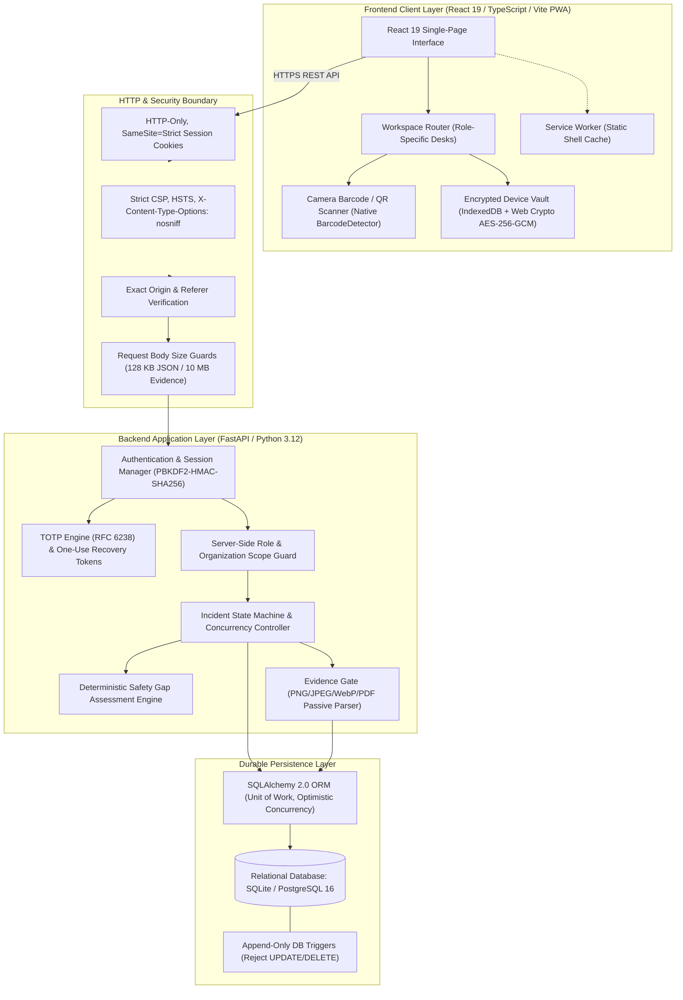
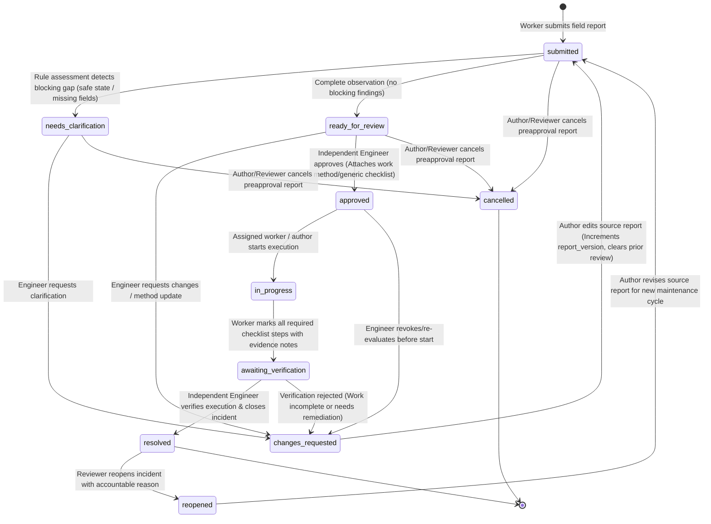
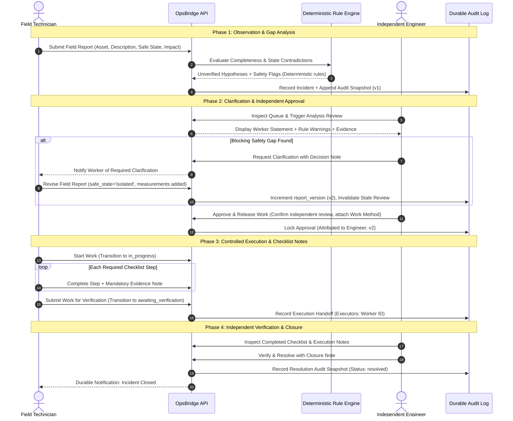
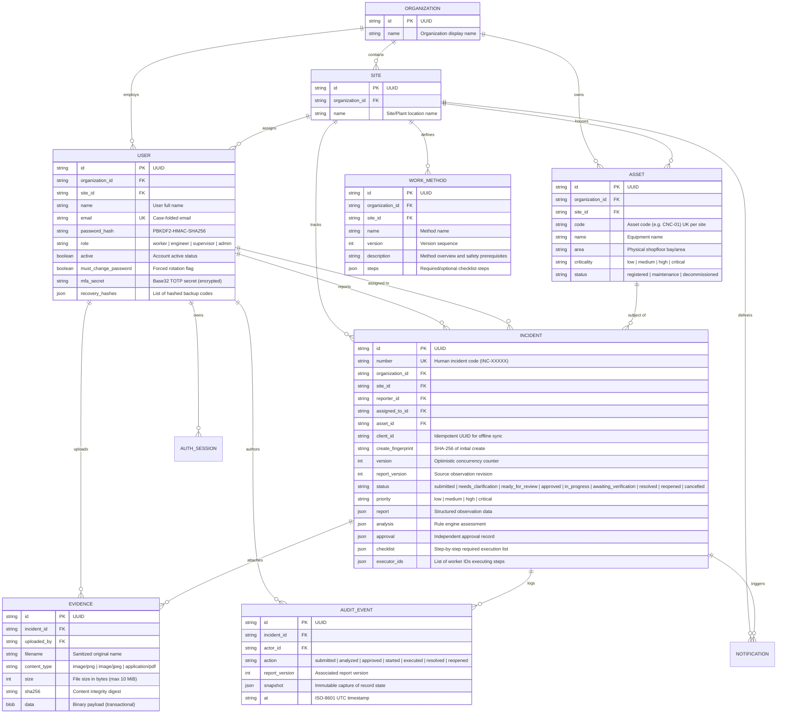

# OpsBridge

**Accountable Industrial Incident Coordination and Dual-Control Release Platform**

[](https://opsbridge-demo.onrender.com)
[](https://github.com/PriyanshuChauhan-007/opsbridge/actions/workflows/ci.yml)
[](https://www.python.org/)
[](https://fastapi.tiangolo.com/)
[](https://react.dev/)
[](https://www.typescriptlang.org/)
[](https://www.postgresql.org/)
[](https://developer.mozilla.org/en-US/docs/Web/API/Web_Crypto_API)

> *"Observe carefully. Decide independently. Leave a clear record."*

---

### Evaluation Environment
- **Hosted Application**: [https://opsbridge-demo.onrender.com](https://opsbridge-demo.onrender.com)
- **Role Switching**: On the login screen, select any demo persona (`Technician`, `Engineer`, `Supervisor`, `Admin`) to tour the platform with pre-authenticated sessions.

---

## Motivation and Problem Statement

In production manufacturing (stamping lines, CNC milling cells, chemical processing units, and automated material handling), machine stoppages cost thousands of dollars per minute. Under pressure to restore equipment throughput, plant maintenance operations often default to informal channels:

- **Messaging apps** where vibration readings, multimeter values, and photos of fractured components get buried without timestamp integrity or cryptographic verification.
- **Verbal shift handoffs** that leave zero record of who authorized an altered machine state.
- **Paper clipboards and spreadsheets** vulnerable to post-incident alteration, missing signatures, and lost records.

### Failure Modes in Informal Plant Coordination
1. **Self-Approval Hazard**: A technician performing an emergency fix often certifies their own work. Without independent peer review, dangerous shortcuts go unnoticed.
2. **Missing Evidence and Broken Provenance**: Photos of damaged assets remain on personal mobile devices with no permanent binding to the work order.
3. **Silent State Drift**: If equipment symptoms worsen or new damage is uncovered after an initial sign-off, work continues under obsolete assumptions.
4. **Regulatory Non-Compliance**: OSHA 1910 (Lockout/Tagout) and ISO 9001/45001 standards require documented dual control ("four-eyes principle"). An engineer cannot approve their own report or execute work they approved; an independent party must confirm safe isolation.

OpsBridge enforces a server-verified human decision loop backed by deterministic safety validation and an append-only audit trail.

---

## System Architecture

OpsBridge connects shopfloor personnel and reliability engineers through a layered, role-enforced architecture designed for human accountability and audit provenance.



---

## Incident State Machine and Concurrency Model

Every incident follows an 11-state finite state machine enforcing separation of duties, optimistic version locking, and automatic invalidation of stale engineering reviews.



### Concurrency Guarantees
1. **Separation of Duties**: The author cannot approve their own report. The approver and executor cannot verify completion.
2. **Version Invalidation**: Any revision to the worker statement increments `report_version`, immediately invalidating previous rule analysis, engineering approval, and active checklists.
3. **Optimistic Locking**: Every mutation requires matching the server's current `version`. Stale concurrent writes are rejected with `HTTP 409 Conflict`.

---

## Separation of Duties and Verification Flow

This sequence illustrates the handoff boundaries between human roles, ensuring that automated rules assist rather than replace accountable engineering judgment:



---

## Relational Data Model (ER Schema)

OpsBridge models physical shopfloor assets, organizations, sites, role-scoped accounts, versioned incidents, checklists, immutable work methods, and append-only audit events.



---

## Role Responsibilities and Guardrails

Trust is anchored in authenticated server sessions. Every approval, evidence upload, checklist step, and closure signature is cryptographically bound to an authenticated identity.

| Role | Demo Account | Password | Primary Responsibilities | Architectural Guardrails |
| :--- | :--- | :--- | :--- | :--- |
| **Field Technician** | `worker@apex.local` | `WorkerPass1234!` | Scans asset QR codes, logs physical symptoms, uploads evidence, executes released checklists. | **Cannot** approve work methods; **cannot** bypass engineering review; **cannot** self-close incidents. |
| **Reliability Engineer** | `engineer@apex.local` | `EngineerPass1234!` | Evaluates deterministic gap findings, requests clarification, selects work methods, approves released work. | **Cannot** approve own submitted reports; **cannot** execute work they approved (separation of duties). |
| **Operations Supervisor** | `supervisor@apex.local` | `SupervisorPass1234!` | Monitors plant queues, prioritizes production downtime, conducts final verification on restored assets. | **Cannot** falsify technician execution notes; verification requires signed completion handoff. |
| **Site Administrator** | `admin@apex.local` | `AdminPass1234!` | Manages asset register, provisions personnel, configures inbound integrations and security settings. | **Cannot** alter append-only audit trail; cannot overwrite versioned history snapshots. |

---

## Technical Design Highlights

### 1. Deterministic Safety Gap Analysis
Industrial life-safety decisions cannot rely on probabilistic text outputs. OpsBridge uses a deterministic rule engine that parses statements and validates physical plant invariants:
- Flags missing electrical, pneumatic, or hydraulic Lockout/Tagout (LOTO) declarations.
- Catches contradictory equipment states (e.g., machine logged as "running" alongside "broken spindle").
- Requires unambiguous injury and hazardous chemical disclosures before status progression.

### 2. Client-Side Encrypted Device Vault (AES-256-GCM)
Technicians operating in radio-shielded basements or metal-clad machine bays can draft observations offline:
- Uses the browser's native **Web Crypto API** with **AES-256-GCM** encryption and keys derived via **PBKDF2** (600,000 iterations).
- Encrypted drafts reside safely in IndexedDB and are never readable by unauthorized local scripts.
- Automatically synchronizes with server-side idempotency keys (`client_id`) upon network reconnection.

### 3. Append-Only Audit Trails and Direct Exports
- **Database Engine Triggers**: Both SQLite triggers (`audit_no_update`, `audit_no_delete`) and PostgreSQL triggers (`reject_audit_mutation()`) prevent mutation of audit history even if ORM controls are bypassed.
- **RFC 4180 CSV Export**: Direct spreadsheet-ready download at `/api/v1/incidents/export?fmt=csv`.
- **Cryptographic JSON Export**: Download complete incident provenance packages with SHA-256 evidence digests.

### 4. Operations Analytics
Derived directly from persisted relational transactions:
- **Mean Time to Resolution (MTTR)**: Median and average resolution durations.
- **7-Day Trend Volumes**: Incoming incident rate vs. completed verifications.
- **Critical Asset Bottlenecks**: Identifies recurring chronic failure equipment across plant cells.

---

## Local Development Setup

### Prerequisites
- **Python 3.12+**
- **Node.js 22+** and `npm`

### 1. Backend Setup
From the repository root:

```sh
# Create virtual environment
python -m venv .venv

# Activate virtual environment
# Windows:
.venv\Scripts\activate
# Linux/macOS:
source .venv/bin/activate

# Install dependencies
pip install -r backend/requirements-dev.txt

# Start FastAPI server
uvicorn backend.main:app --host 127.0.0.1 --port 8000 --reload
```

Backend will be running at `http://127.0.0.1:8000`. Health check endpoint: `http://127.0.0.1:8000/api/v1/health`.

### 2. Frontend Setup
In a second terminal:

```sh
cd frontend
npm ci
npm run dev
```

Open `http://127.0.0.1:5173` in your browser.

### 3. Demo Data Seeding
In a third terminal, run the automated seeder script:

```sh
python scripts/demo_setup.py --reset
```

This registers:
- Organization: **Apex Precision Dynamics** (`Plant Alpha - Machining Cell`)
- 4 Authenticated Personnel (`worker`, `engineer`, `supervisor`, `admin`)
- CNC Mill, Hydraulic Press, and Conveyor assets
- Pre-configured incidents across workflow stages (`Needs Clarification`, `Approved`, `Resolved`)

---

## Testing and Quality Assurance

OpsBridge includes automated test suites across backend and frontend layers:

```sh
# Backend test suite (FastAPI + SQLAlchemy + Contract tests)
python -m pytest backend/tests -v

# PostgreSQL isolation and transaction test suite
pytest backend/tests/test_postgres.py -v

# Frontend unit tests
cd frontend
npm test

# Production build check
npm run build

# End-to-end integration tests (Playwright)
npm run test:e2e
```

---

## Deployment

OpsBridge is packaged for containerized deployment or direct deployment on Render via [`render.yaml`](render.yaml):

```sh
# Build and run multi-stage Docker container
docker build -t opsbridge .
docker run -p 8000:8000 -e APP_ENV=production -e SECRET_KEY="your-secret" opsbridge
```

### Production Security Checklist
- Set `APP_ENV=production`
- Configure PostgreSQL database URL (`postgresql+psycopg://...`)
- Set `COOKIE_SECURE=true` and bind to HTTPS origin
- Set `FIELD_ENCRYPTION_KEY` using a 32-byte Fernet key

---

## Project Information

- **Author**: Priyanshu Chauhan
- **Repository**: [github.com/PriyanshuChauhan-007/opsbridge](https://github.com/PriyanshuChauhan-007/opsbridge)
- **Specialization**: Full-Stack Architecture, Industrial Safety Systems, Deterministic Workflow Engineering

### Safety Disclaimer
*OpsBridge is an academic software engineering project demonstrating application architecture, role-based workflow coordination, and tamper-evident audit trails. It is not a certified Safety Integrity Level (SIL) system or a certified hardware interlock. Never treat software state as physical equipment isolation. Always adhere to site Lockout/Tagout (LOTO) protocols, PPE guidelines, and qualified human directives.*
