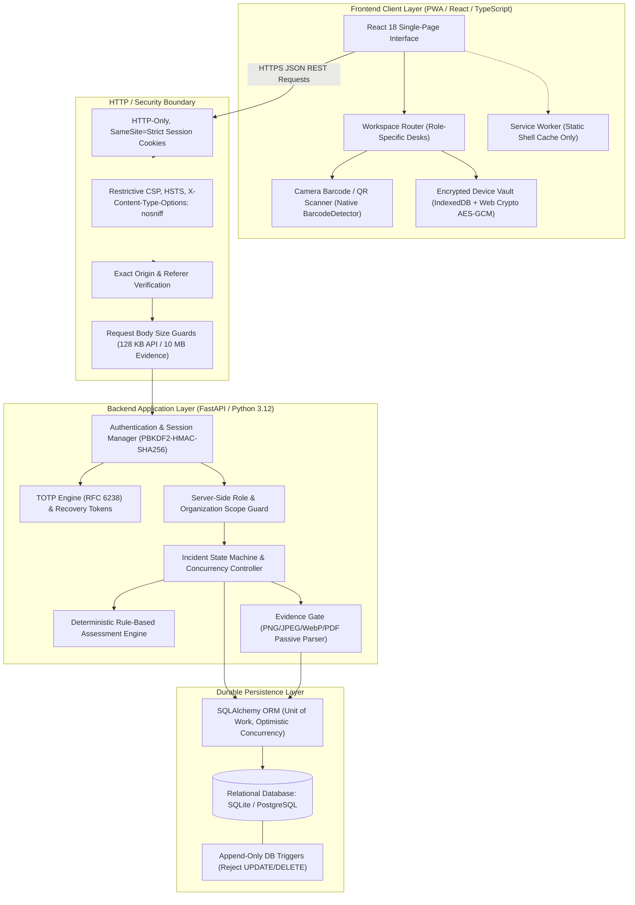
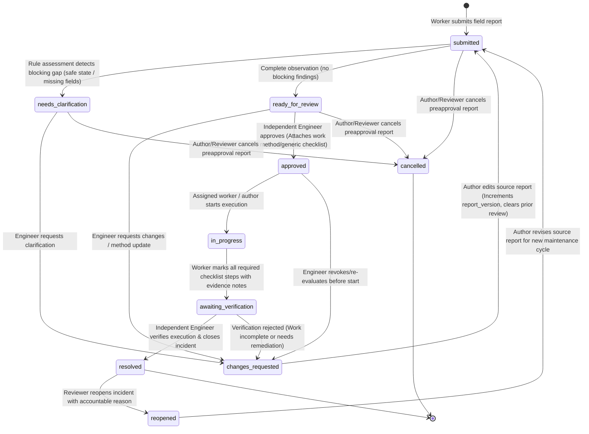
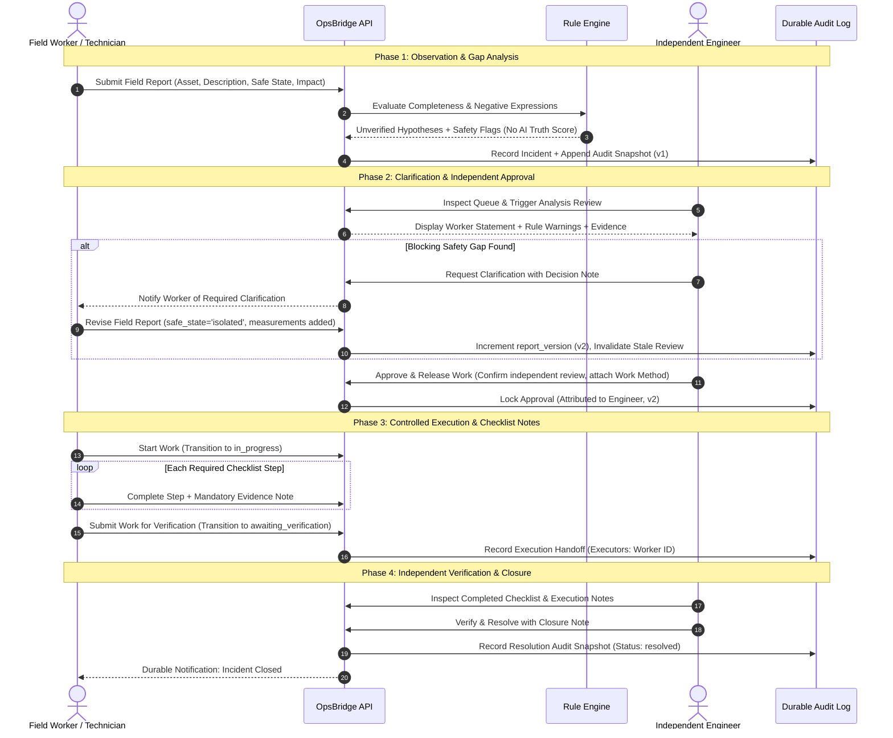
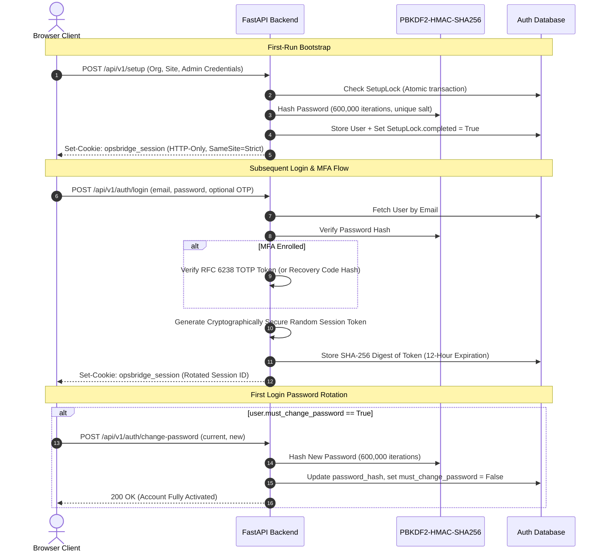
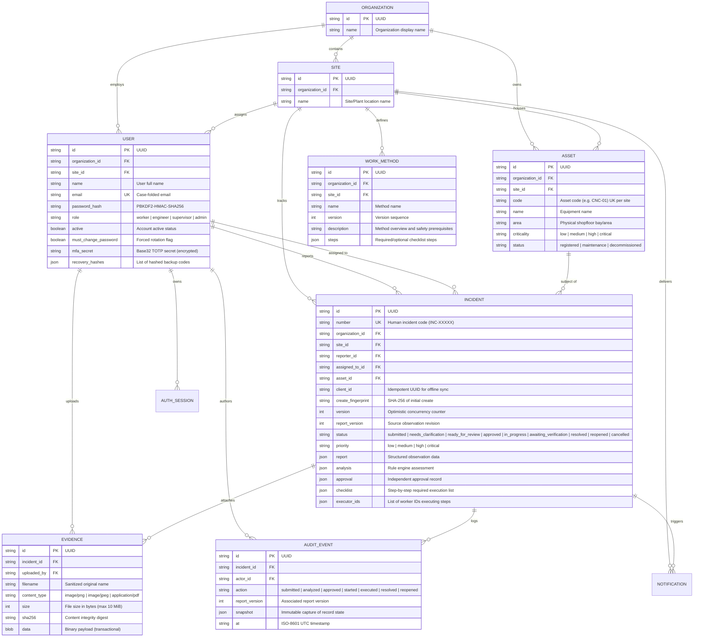
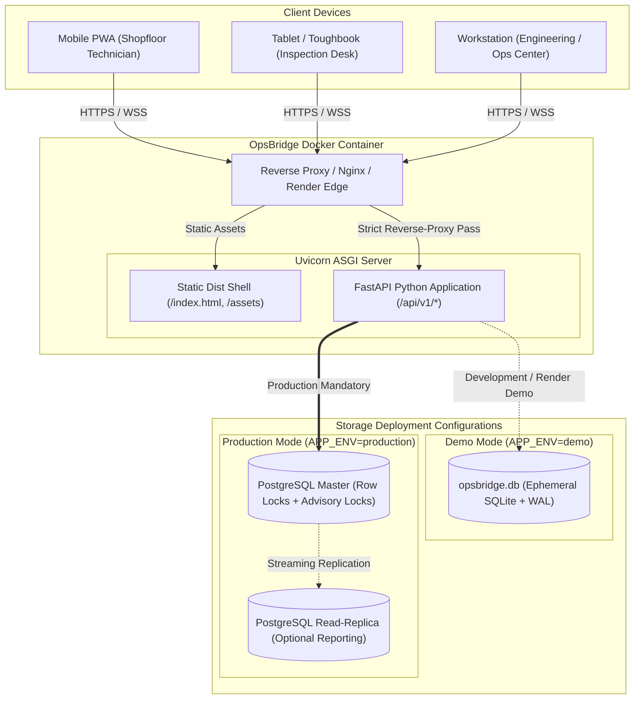

# OpsBridge: System Architecture & Design Diagrams

This document contains architectural diagrams and technical design specifications for **OpsBridge**. These diagrams illustrate the system components, incident state machine, database schema, security boundaries, and runtime deployment topologies.

---

## 1. High-Level System Architecture

OpsBridge connects shopfloor workers and reliability engineers through a layered, role-enforced architecture designed for strict human accountability and audit provenance.

---

## 2. Incident State-Transition & Concurrency Diagram

The incident lifecycle implements an **11-state finite state machine** enforcing separation of duties, version-checked concurrency, and automatic invalidation of stale engineering approvals.

### Key Lifecycle Principles:
1. **Separation of Duties**: The author or recorded executor cannot approve their own report. The approver and executor cannot verify completion.
2. **Version Invalidation**: Any revision to the worker statement increments `report_version`, invalidating previous rule analysis, engineering approval, and active checklists.
3. **Optimistic Locking**: Every mutation requires matching the server's current `version`. Stale concurrent writes are rejected with HTTP 409 Conflict.

---

## 3. Separation of Duties & Human Accountability Flow

This sequence illustrates the exact handoff boundaries between human roles, proving that rules assist rather than replace engineering decisions.

---

## 4. Authentication, Session & Credential Security Flow

Authentication uses cryptographic password hashing, strict cookie-based session management, mandatory password rotation, and multi-factor authentication (TOTP).

---

## 5. Entity-Relationship (ER) Schema Diagram

OpsBridge models physical shopfloor assets, organizations, sites, role-scoped accounts, versioned incidents, checklists, immutable work methods, and append-only audit events.

---

## 6. Runtime & Deployment Topology

OpsBridge is designed for flexible deployment: from lightweight single-container cloud demonstrations to production high-availability multi-tier deployments with PostgreSQL.

---

## 7. Audit Immutability & Database Triggers

Audit events in OpsBridge are protected at multiple defensive tiers:
1. **Application / ORM Tier**: SQLAlchemy lifecycle listeners intercept and reject any `UPDATE` or `DELETE` attempt on `AuditEvent`, `AdminAudit`, or `WorkMethod` entities.
2. **Database Engine Tier**: Native database triggers (`audit_no_update` and `audit_no_delete` in SQLite; `reject_audit_mutation()` in PostgreSQL) abort mutations at the SQL engine level.
3. **Data Provenance Tier**: Every transition saves a snapshot of the exact report state, actor identity, decision note, and timestamp.
